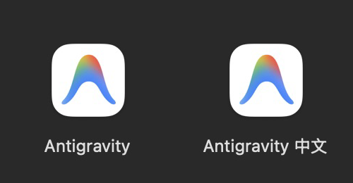

# Antigravity 中文

> Ready-to-use **full Chinese experience** for Antigravity Desktop — creates a dedicated **Antigravity 中文** shortcut for **Chinese UI + Chinese AI thinking & replies**, while keeping the original **Antigravity** app completely untouched.

[简体中文](README.md) · [English](README.en.md)


<details>
<summary>More real screenshots (Chinese welcome page & dual-entry icons)</summary>




</details>

## ⚡ One-Line Install

**macOS** (paste into **Terminal**):

```bash
curl -fsSL https://raw.githubusercontent.com/guuguo/antigravity-zh-launcher/main/install.sh | bash
```

**Windows** (paste into **PowerShell**):

```powershell
irm https://raw.githubusercontent.com/guuguo/antigravity-zh-launcher/main/install.ps1 | iex
```

---

## ✨ How to Use

- **Open Chinese mode**: Launch **Antigravity 中文** from your **Desktop / Start Menu (Windows)** or **Applications / Spotlight (macOS)** to get a Chinese UI plus Chinese AI thinking and answers.
- **Keep stock English**: Launch your existing **Antigravity** icon anytime for the original untouched English interface and prompts.
- **Auto-resets on exit**: Exiting Chinese mode or switching back automatically restores the clean stock prompt state so the two entries never interfere.
- **Pure-script, zero binaries**: Uses native PowerShell (.NET WebSocket) on Windows and Bash/Python on macOS for local CDP injection — **no external `.exe` or compiled binaries** are downloaded or executed, avoiding antivirus heuristic false positives.

---

## 🗑️ One-Line Uninstall

Remove the Chinese shortcut and restore defaults anytime without touching the stock app:

**macOS:**

```bash
curl -fsSL https://raw.githubusercontent.com/guuguo/antigravity-zh-launcher/main/uninstall.sh | bash
```

**Windows (PowerShell):**

```powershell
irm https://raw.githubusercontent.com/guuguo/antigravity-zh-launcher/main/uninstall.ps1 | iex
```

---

[Advanced Usage & Custom Prompts (CLI / Purge Uninstall) →](docs/usage.en.md)

## Credits & License

- Base UI localization JS script referenced from [yuexps/Antigravity-Hans](https://github.com/yuexps/Antigravity-Hans) · Launcher released under the [MIT License](LICENSE)
- Shout-out to the [LINUX DO](https://linux.do/) community for feedback and support
