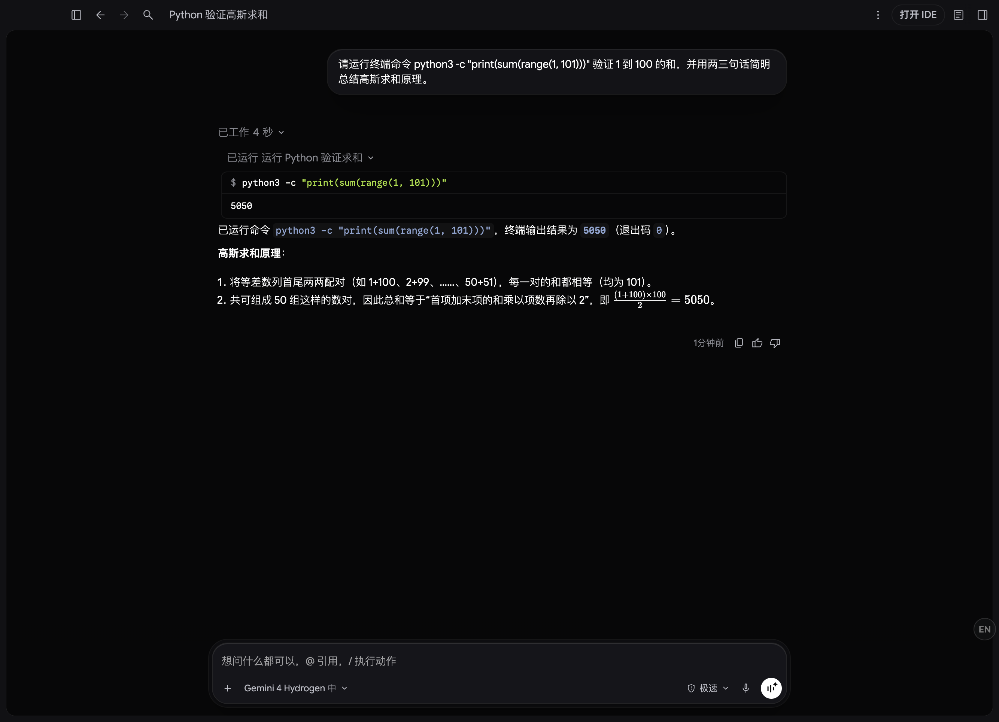
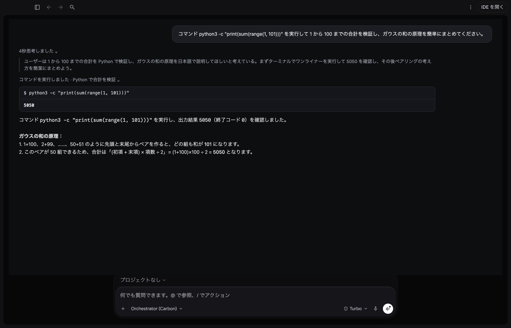
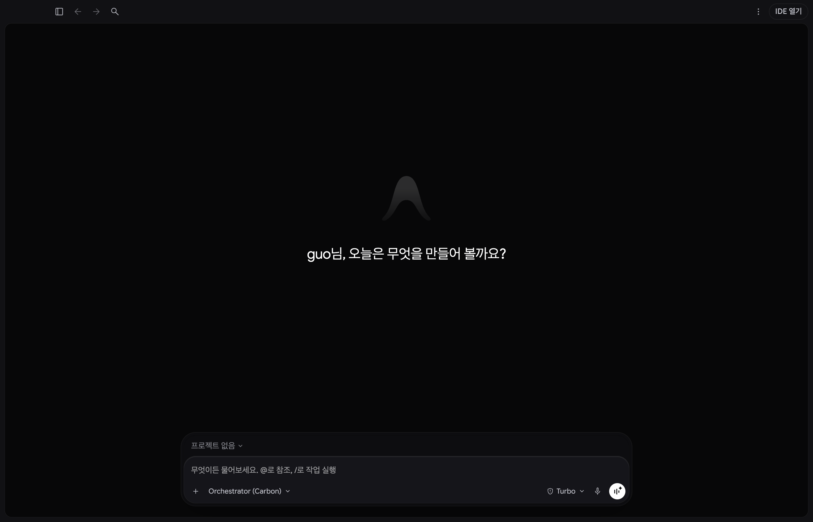
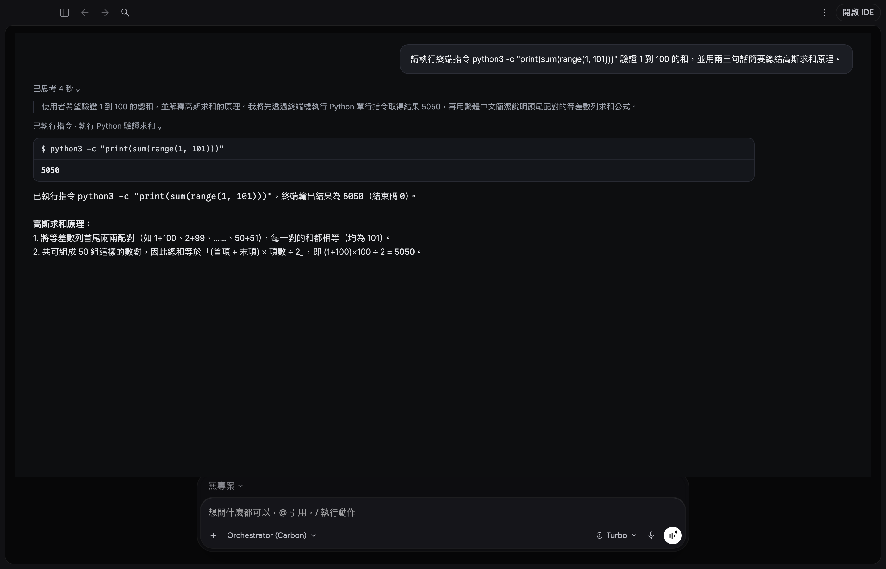
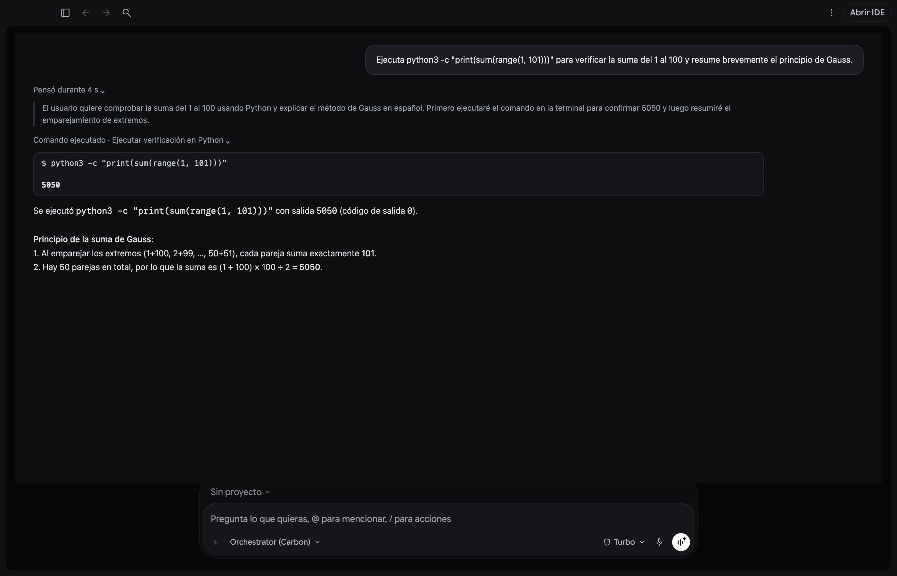
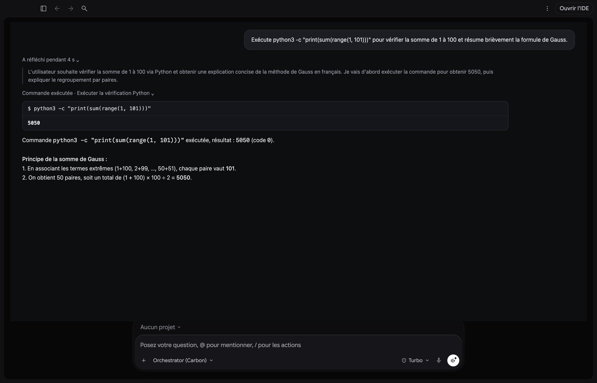
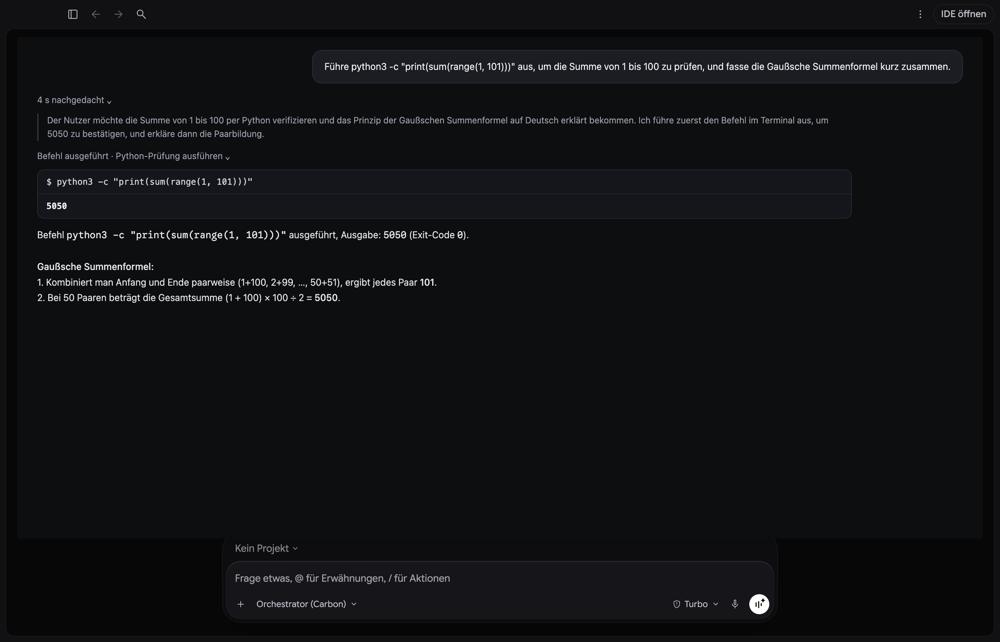
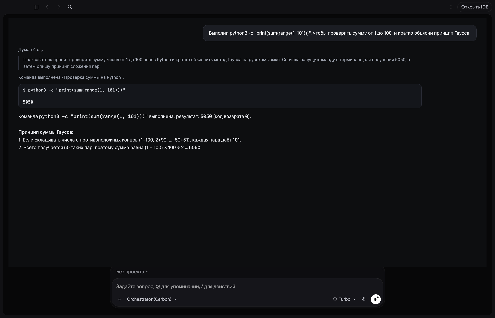
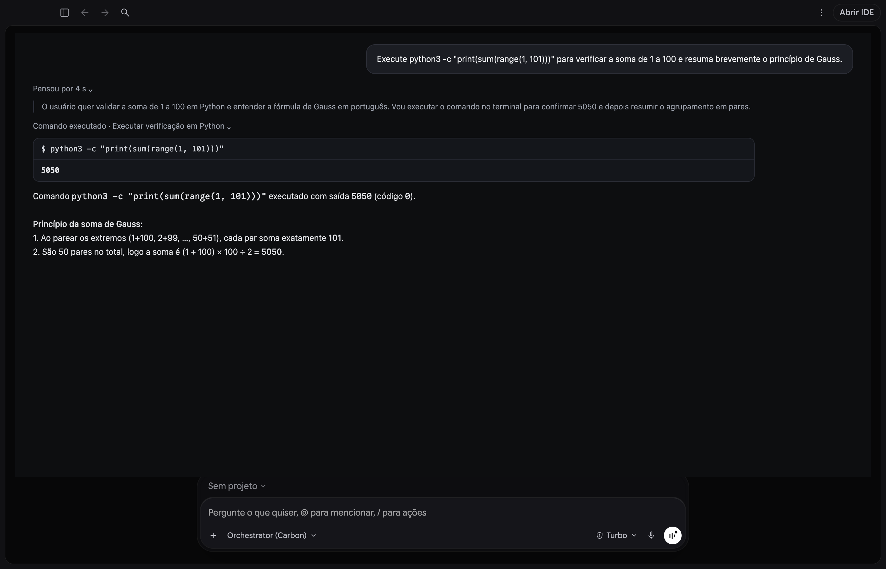

[简体中文](README.md) · [English](README.en.md) · [日本語](README.ja.md) · [한국어](README.ko.md) · [繁體中文](README.zh-TW.md)

# Antigravity Multilingual Launcher

Separate language shortcuts, localized UI, and AI language rules for Antigravity. Installing without arguments still selects **zh-CN / Antigravity 中文**. Existing `agy-zh` commands, caches, and plugin paths remain compatible. The original application files stay untouched.



<details>
<summary>More Language Screenshots (繁體中文 / 日本語 / 한국어 / Español / Français / Deutsch / Русский / Português)</summary>

| 日本語 (`ja`) | 한국어 (`ko`) |
| --- | --- |
|  |  |

| 繁體中文 (`zh-TW`) | Español (`es`) |
| --- | --- |
|  |  |

| Français (`fr`) | Deutsch (`de`) |
| --- | --- |
|  |  |

| Русский (`ru`) | Português (`pt-BR`) |
| --- | --- |
|  |  |

</details>

## Install

The original default install commands still select Simplified Chinese:

```bash
curl -fsSL https://raw.githubusercontent.com/guuguo/antigravity-zh-launcher/main/install.sh | bash
```

```powershell
irm https://raw.githubusercontent.com/guuguo/antigravity-zh-launcher/main/install.ps1 | iex
```

Install Antigravity first. macOS requires Bash, Python 3, and curl. Windows uses built-in Windows PowerShell 5.1. Node.js is not required at runtime.

Install from a local checkout:

```bash
bash install.sh --lang ja
```

```powershell
powershell -NoProfile -ExecutionPolicy Bypass -File .\install.ps1 --lang ja
```

Remote installation (Japanese example; omit `--lang ja` for Simplified Chinese):

```bash
curl -fsSL https://raw.githubusercontent.com/guuguo/antigravity-zh-launcher/main/install.sh | bash -s -- --lang ja
```

```powershell
& ([scriptblock]::Create((irm https://raw.githubusercontent.com/guuguo/antigravity-zh-launcher/main/install.ps1))) --lang ja
```

| Code | Language | Entry | CLI |
| --- | --- | --- | --- |
| `zh-CN` | 简体中文 (default) | Antigravity 中文 | `agy-zh` |
| `zh-TW` | 繁體中文 | Antigravity 繁體中文 | `agy-zh-tw` |
| `ja` | 日本語 | Antigravity 日本語 | `agy-ja` |
| `ko` | 한국어 | Antigravity 한국어 | `agy-ko` |
| `es` | Español | Antigravity Español | `agy-es` |
| `fr` | Français | Antigravity Français | `agy-fr` |
| `de` | Deutsch | Antigravity Deutsch | `agy-de` |
| `ru` | Русский | Antigravity Русский | `agy-ru` |
| `pt-BR` | Português (Brasil) | Antigravity Português | `agy-pt-br` |

## Use and uninstall

Multiple language shortcuts can coexist. Antigravity shares one desktop session: switching languages stops the previous injector and enables only the selected prompt plugin. The plugin is disabled when the localized session exits. Quit that session before reopening the stock entry.

```bash
agy-zh --lang ja start
agy-zh --lang ja status
agy-zh --lang ja prompt status
bash uninstall.sh --lang ja --purge
```

```powershell
agy-zh --lang ja start
powershell -NoProfile -ExecutionPolicy Bypass -File .\uninstall.ps1 --lang ja --purge
```

Uninstall defaults to Simplified Chinese. `--lang` removes only the selected language. Shared runtime files are removed after the last installed language. `--purge` also removes the corresponding cache without removing other language entries.

`--no-shortcut` · `--update-engine` · `--dry-run` · `--help`

Windows: `-Lang`, `-NoShortcut`, `-UpdateEngine`, `-DryRun` are also supported. Existing `AGY_ZH_UPDATE_ENGINE`, `AGY_ZH_NO_SHORTCUT`, `AGY_ZH_PURGE`, `AGY_ZH_REPO_RAW`, `AGY_ZH_OVERLAY_URL`, and `GEMINI_CONFIG_DIR` settings remain supported.

## Architecture and validation

`locales/index.json` declares languages, entry names, commands, and plugins. All nine JSON dictionaries share the same keys for common IDE commands, agent interactions, and tool states. Greetings use templates; relative times use `Intl.RelativeTimeFormat`.

Simplified Chinese retains the original upstream dictionary and enhancements (`lib/zh-overlay.*`). Other languages share `lib/overlay.js`. Runtime injection skips code editors, user input, conversation titles, and response bodies. Unlisted strings and future UI additions remain unchanged. These are community overlays, not official Antigravity language packs.

Prompt plugins guide plans, shareable reasoning summaries, tool summaries, and answers into the target language while preserving code, paths, and original errors. Model compliance and internal reasoning language are determined by the model.

```bash
python3 tests/test_launcher.py
node tests/overlay.test.js
# Windows PowerShell: & .\tests\powershell.test.ps1
```

[MIT License](LICENSE) · [Upstream Chinese dictionary / 原有中文词库](https://github.com/yuexps/Antigravity-Hans) · [CLI details](docs/usage.en.md)
