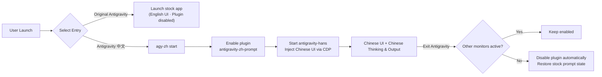

<div align="center">

# Antigravity Chinese Launcher (`antigravity-zh-launcher`)

**Non-Intrusive Dual-Entry Chinese Launcher & Full-Workflow Chinese Thinking Prompt Suite for Google Antigravity 2.0+**

[简体中文](README.md) · [English](README.en.md)

[](LICENSE)
[](#quick-install)
[](#key-features)
[](#comparison)

</div>

---

Want to keep your **original English Antigravity** completely untouched while having a dedicated **Chinese entry** where both the **UI** and the **AI's Thinking, Plan, and Responses** stay in Simplified Chinese?

`antigravity-zh-launcher` creates a cleanly isolated **“Antigravity 中文”** entry alongside your stock installation:

- **Launch original Antigravity**: 100% stock English UI + 100% original global prompts.
- **Launch “Antigravity 中文”**: Automatically enables the full-workflow Chinese thinking prompt plugin + launches CDP-based live UI localization. As soon as you exit, the prompt plugin is **automatically turned back off**.

---

## Key Features

- **Strict Dual-Entry Isolation**: Keeps the stock `Antigravity` app and the Chinese entry completely separate—no need to edit `GEMINI.md` back and forth.
- **Zero ASAR Patching & Signature Safe**: Never touches `app.asar` or app binaries. Google's official code signature, macOS `ElectronAsarIntegrity`, Keychain tokens, and auto-updates remain 100% intact.
- **UI + Thinking Prompt Synchronization**: Ships a native Antigravity plugin (`antigravity-zh-prompt`, disabled by default) that guides the agent during Chinese sessions to:
  - Think (`Thinking` / reasoning chain) and plan (`Plan`) in Simplified Chinese;
  - Write user-facing replies, artifacts, tool summaries, and subagent descriptions in Simplified Chinese;
  - Preserve code identifiers, CLI flags, file paths, and verbatim errors in English.
- **Instant In-App UI Language Toggle**: Features a floating **中 / EN** pill in the bottom-right corner to toggle UI language live without restarting.
- **One-Command Install & Uninstall**: Works out-of-the-box on macOS (Apple Silicon & Intel) and Windows with automatic SHA-256 verification.

---

## Comparison

| Dimension | Static `app.asar` Patching | Hardcoding Chinese in `GEMINI.md` | **This Project (Dual-Entry Sync)** |
| --- | --- | --- | --- |
| Official Code Signature & Integrity | Broken (requires re-signing) | Intact (no UI translation) | **100% Intact** |
| Original English Entry Purity | Overwritten globally | Polluted by Chinese rules | **Completely clean & isolated** |
| UI Localization | Breaks on every app update | None | **Live CDP injection + instant toggle** |
| Chinese Thinking Chain | Not covered | Affects all sessions | **Scoped strictly to Chinese entry** |
| Uninstall Effort | Restore backup ASAR | Manual config cleanup | **One-command clean removal** |

---

## How It Works



---

## Quick Install

> **Prerequisite**: [Google Antigravity 2.0+](https://antigravity.google) installed. The installer downloads the official `antigravity-hans` binary from upstream GitHub Releases and verifies its **SHA-256 checksum** automatically.

### macOS (Apple Silicon & Intel)

```bash
curl -fsSL https://raw.githubusercontent.com/guuguo/antigravity-zh-launcher/main/install.sh | bash
```

What gets installed:
- Standalone launcher app: `/Applications/Antigravity 中文.app` (with `LSUIElement = true` so no duplicate Dock icon appears)
- Orchestrator CLI: `~/.local/bin/agy-zh`
- Prompt plugin: `~/.gemini/config/plugins/antigravity-zh-prompt` (disabled by default)

### Windows (10 / 11 PowerShell)

```powershell
irm https://raw.githubusercontent.com/guuguo/antigravity-zh-launcher/main/install.ps1 | iex
```

What gets installed:
- Desktop shortcut: `Antigravity 中文` (inherits official icon, launches silently without a console window)
- Orchestrator scripts: `%LOCALAPPDATA%\antigravity-zh-launcher\bin\agy-zh.cmd`
- Prompt plugin: `%USERPROFILE%\.gemini\config\plugins\antigravity-zh-prompt` (disabled by default)

---

## Usage

1. **Chinese Mode**: Open **“Antigravity 中文”** from Applications / Spotlight (macOS) or your Desktop shortcut (Windows).
   > **Tip**: If the original Antigravity app is already running without a debug port, quit it completely first (`⌘Q` on macOS) before opening “Antigravity 中文”.
2. **Original English Mode**: After exiting Chinese mode, simply open the original **Antigravity** app—both UI and agent prompts return to stock behavior.
3. **In-App Toggle**: Click the translucent **中 / EN** button in the bottom-right corner to switch UI languages on the fly, or right-click / double-click it for options.

---

## CLI Reference

Run `agy-zh` in your terminal (or `%LOCALAPPDATA%\antigravity-zh-launcher\bin\agy-zh.cmd` on Windows):

| Command | Description |
| --- | --- |
| `agy-zh start` | Enable prompt plugin, launch Antigravity in Chinese, and auto-restore on exit |
| `agy-zh stop` | Stop the UI localization monitor and disable the Chinese prompt plugin |
| `agy-zh status` | Show status of both entries, CDP engine, plugin installation, and toggle state |
| `agy-zh prompt on \| off \| status` | Manually toggle or inspect the `antigravity-zh-prompt` plugin |
| `agy-zh shortcut` | Recreate the “Antigravity 中文” app/shortcut |

---

## Customizing the Chinese Prompt

Edit the rules file inside the installed plugin:
- **macOS**: `~/.gemini/config/plugins/antigravity-zh-prompt/rules/AGENTS.md`
- **Windows**: `%USERPROFILE%\.gemini\config\plugins\antigravity-zh-prompt\rules\AGENTS.md`

Changes take effect only when launching through **“Antigravity 中文”** and never affect the original entry.

---

## Clean Uninstall

- **macOS**:
  ```bash
  curl -fsSL https://raw.githubusercontent.com/guuguo/antigravity-zh-launcher/main/uninstall.sh | bash

  # Also remove ~/.local/bin/antigravity-hans:
  curl -fsSL https://raw.githubusercontent.com/guuguo/antigravity-zh-launcher/main/uninstall.sh | bash -s -- --purge
  ```

- **Windows (PowerShell)**:
  ```powershell
  irm https://raw.githubusercontent.com/guuguo/antigravity-zh-launcher/main/uninstall.ps1 | iex
  ```
  *(Pass `-Purge` when running locally to remove the engine directory as well.)*

---

## Credits & Disclaimer

- Powered by **[yuexps/Antigravity-Hans](https://github.com/yuexps/Antigravity-Hans)** for live CDP UI localization. This repository does not redistribute upstream binaries; installers fetch official release assets on demand and verify `SHA256SUMS`.
- Unofficial community project; not affiliated with or endorsed by Google LLC.
- Licensed under the [MIT License](LICENSE).
