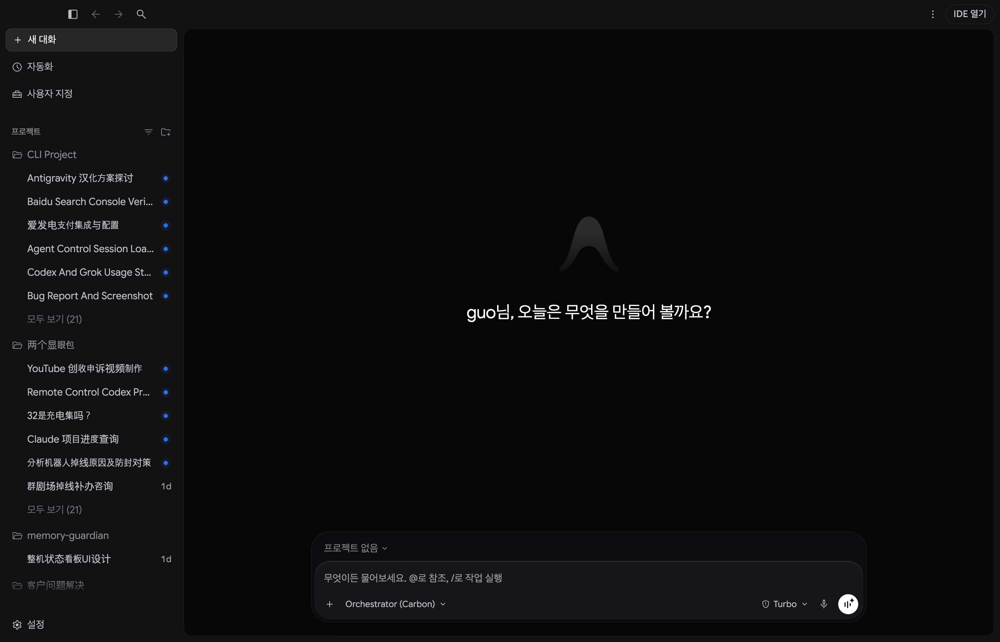

[简体中文](README.md) · [English](README.en.md) · [日本語](README.ja.md) · [한국어](README.ko.md) · [繁體中文](README.zh-TW.md)

# Antigravity 다국어 런처

Antigravity에 언어별 실행 아이콘, UI 번역 및 AI 언어 규칙을 추가합니다. 인수 없이 설치하면 기존과 동일하게 **zh-CN / Antigravity 中文**을 사용합니다. 기존 `agy-zh` 명령과 경로를 유지하며 원본 앱 파일은 변경하지 않습니다.



## 설치

먼저 Antigravity를 설치하세요. macOS는 Bash, Python 3, curl을, Windows는 기본 제공 Windows PowerShell 5.1을 사용합니다. 실행 시 Node.js는 필요하지 않습니다.

로컬 저장소에서 설치:

```bash
bash install.sh --lang ko
```

```powershell
powershell -NoProfile -ExecutionPolicy Bypass -File .\install.ps1 --lang ko
```

원격 설치(한국어 예시. 인수를 생략하면 중국어 간체):

```bash
curl -fsSL https://raw.githubusercontent.com/guuguo/antigravity-zh-launcher/main/install.sh | bash -s -- --lang ko
```

```powershell
& ([scriptblock]::Create((irm https://raw.githubusercontent.com/guuguo/antigravity-zh-launcher/main/install.ps1))) --lang ko
```

| Code | Language / 语言 | Entry | CLI |
| --- | --- | --- | --- |
| `zh-CN` | 简体中文（默认） | Antigravity 中文 | `agy-zh` |
| `zh-TW` | 繁體中文 | Antigravity 繁體中文 | `agy-zh-tw` |
| `ja` | 日本語 | Antigravity 日本語 | `agy-ja` |
| `ko` | 한국어 | Antigravity 한국어 | `agy-ko` |
| `es` | Español | Antigravity Español | `agy-es` |
| `fr` | Français | Antigravity Français | `agy-fr` |
| `de` | Deutsch | Antigravity Deutsch | `agy-de` |
| `ru` | Русский | Antigravity Русский | `agy-ru` |
| `pt-BR` | Português (Brasil) | Antigravity Português | `agy-pt-br` |

## 실행 및 제거

여러 언어의 아이콘을 함께 설치할 수 있습니다. 데스크톱 세션은 공유되므로 언어를 전환하면 이전 주입기를 중지하고 선택한 언어의 플러그인만 활성화합니다. 세션을 종료하면 플러그인이 비활성화됩니다. 원본 영어 버전을 사용하려면 번역 세션을 종료한 뒤 원본 아이콘으로 실행하세요.

```bash
agy-zh --lang ko start
agy-zh --lang ko status
agy-zh --lang ko prompt status
bash uninstall.sh --lang ko --purge
```

```powershell
agy-zh --lang ko start
powershell -NoProfile -ExecutionPolicy Bypass -File .\uninstall.ps1 --lang ko --purge
```

기본 제거 대상은 중국어 간체입니다. `--lang`으로 지정한 언어만 제거합니다. 마지막 언어를 제거하면 공통 런타임도 정리합니다. `--purge`는 해당 캐시도 제거하며 다른 언어의 아이콘은 유지합니다.

`--no-shortcut` · `--update-engine` · `--dry-run` · `--help`

Windows에서는 `-Lang`, `-NoShortcut`, `-UpdateEngine`, `-DryRun`도 지원합니다. 기존 `AGY_ZH_*` 및 `GEMINI_CONFIG_DIR` 설정도 유지됩니다.

## 구조 및 검증

`locales/index.json`이 언어, 아이콘 이름, 명령 및 플러그인을 정의합니다. 9개 JSON 사전은 동일한 키를 사용하며 일반적인 IDE 작업, 에이전트 상호작용 및 도구 상태를 포함합니다. 인사말은 템플릿을, 상대 시간은 `Intl.RelativeTimeFormat`을 사용합니다.

중국어 간체는 기존 상위 사전과 보완 처리(`lib/zh-overlay.*`)를 유지합니다. 다른 언어는 `lib/overlay.js`를 공유합니다. 코드 편집 영역, 사용자 입력, 대화 제목 및 답변 본문은 번역하지 않습니다. 미등록 문자열과 새 UI는 원문을 유지합니다. 공식 언어 팩이 아닌 커뮤니티 오버레이입니다.

언어 플러그인은 계획, 공개 가능한 추론 요약, 도구 요약 및 답변에 대상 언어를 사용하도록 안내합니다. 코드, 경로 및 원본 오류는 유지됩니다. 실제 준수 여부와 내부 사고 언어는 모델에 따라 달라집니다.

```bash
python3 tests/test_launcher.py
node tests/overlay.test.js
# Windows PowerShell: & .\tests\powershell.test.ps1
```

[MIT License](LICENSE) · [Upstream Chinese dictionary / 原有中文词库](https://github.com/yuexps/Antigravity-Hans) · [CLI details](docs/usage.en.md)
