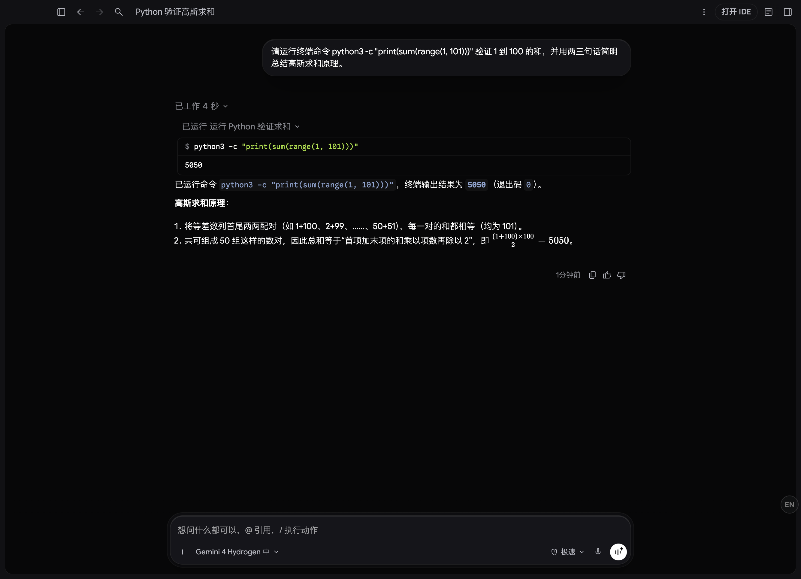
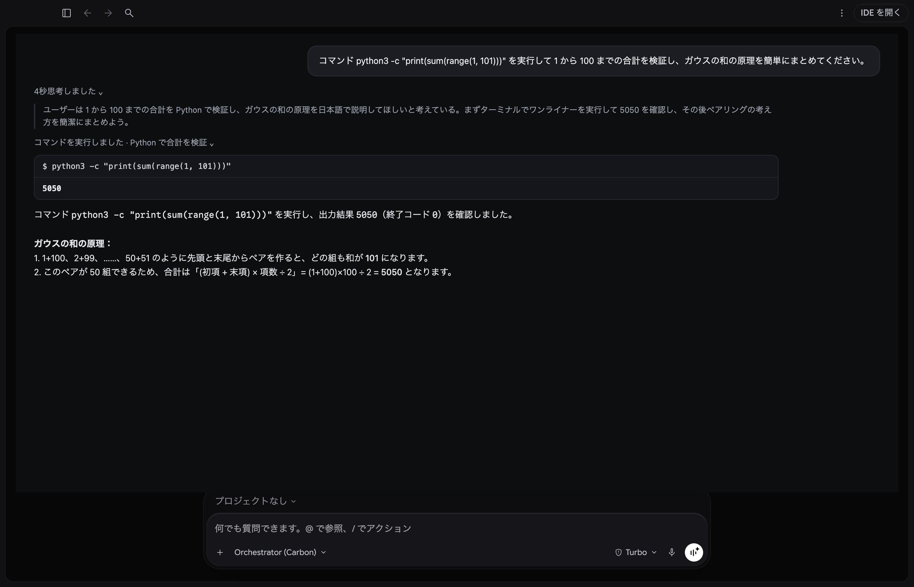
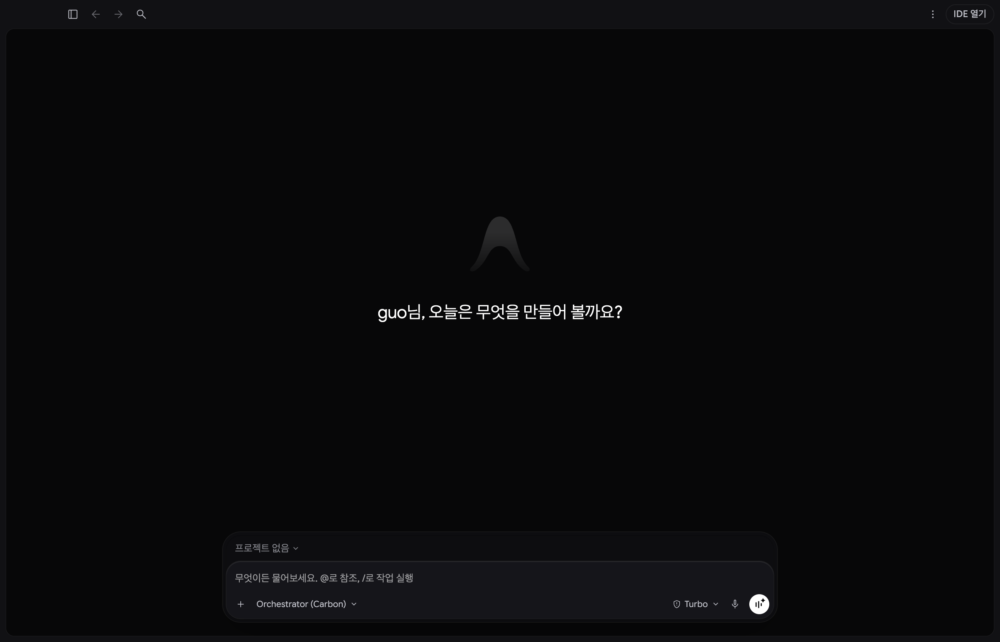
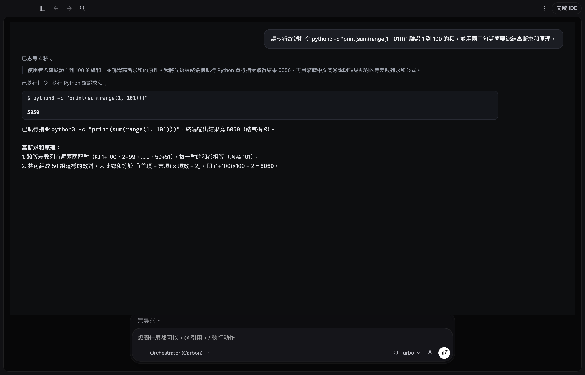
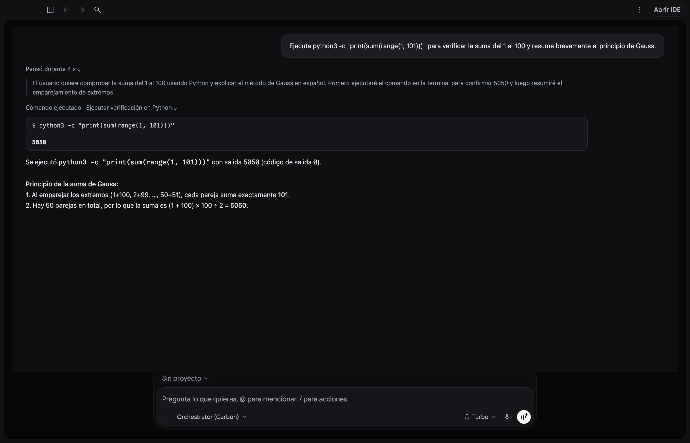
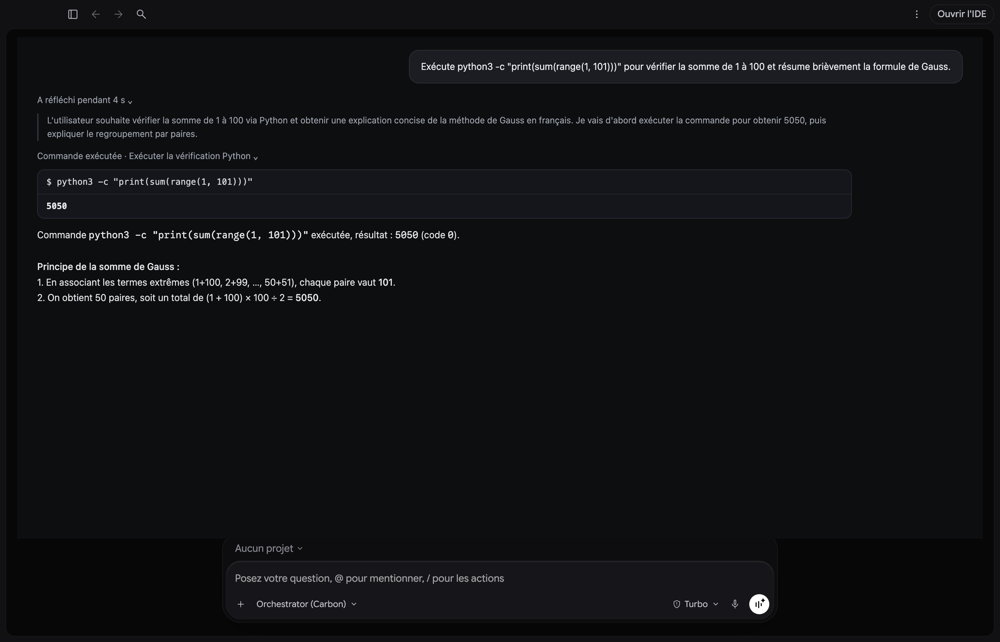
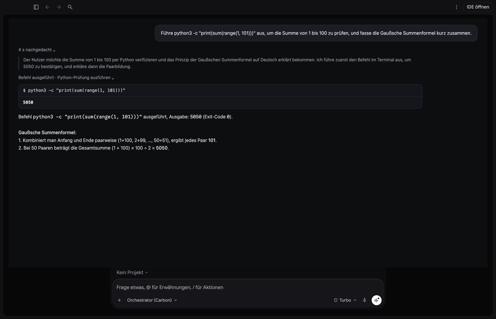
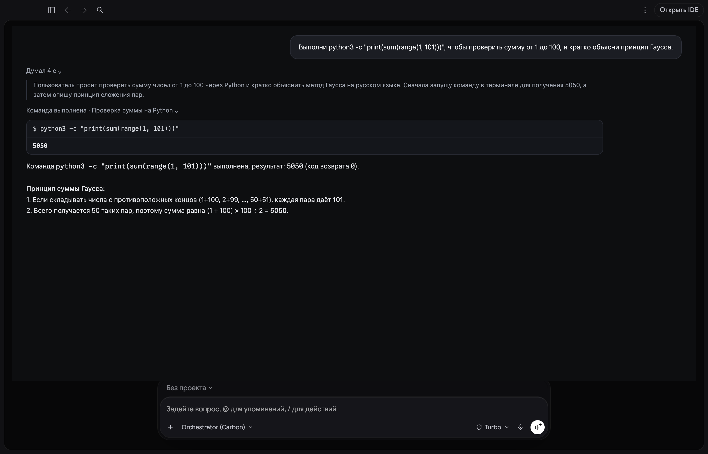
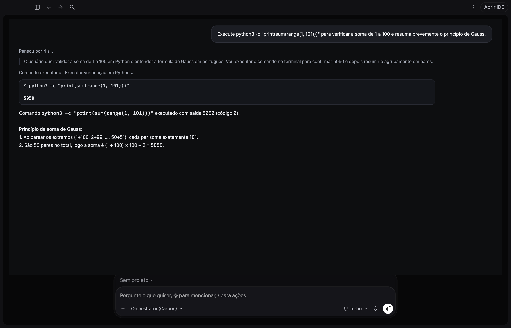

[简体中文](README.md) · [English](README.en.md) · [日本語](README.ja.md) · [한국어](README.ko.md) · [繁體中文](README.zh-TW.md)

# Antigravity 多语言启动器

为 Antigravity 提供独立语言入口、界面翻译和 AI 语言规则。无参数安装仍为 **zh-CN / Antigravity 中文**，原有 `agy-zh` 命令、缓存与插件路径兼容。原版应用文件保持不变。



<details>
<summary>更多语言实拍截图（繁體中文 / 日本語 / 한국어 / Español / Français / Deutsch / Русский / Português）</summary>

| 日本語 (`ja`) | 한국어 (`ko`) |
| --- | --- |
|  |  |

| 繁體中文 (`zh-TW`) | Español (`es`) |
| --- | --- |
|  |  |

| Français (`fr`) | Deutsch (`de`) |
| --- | --- |
|  |  |

| Русский (`ru`) | Português (`pt-BR`) |
| --- | --- |
|  |  |

</details>

## 安装

默认简体中文的一行安装命令继续有效：

```bash
curl -fsSL https://raw.githubusercontent.com/guuguo/antigravity-zh-launcher/main/install.sh | bash
```

```powershell
irm https://raw.githubusercontent.com/guuguo/antigravity-zh-launcher/main/install.ps1 | iex
```

安装前先安装 Antigravity。macOS 需要 Bash、Python 3、curl；Windows 使用系统自带 Windows PowerShell 5.1。无需 Node.js 或外部可执行引擎。

从本地仓库安装：

```bash
bash install.sh --lang zh-CN
```

```powershell
powershell -NoProfile -ExecutionPolicy Bypass -File .\install.ps1 --lang zh-CN
```

远程安装（示例：日语；省略 `--lang ja` 即为简体中文）：

```bash
curl -fsSL https://raw.githubusercontent.com/guuguo/antigravity-zh-launcher/main/install.sh | bash -s -- --lang ja
```

```powershell
& ([scriptblock]::Create((irm https://raw.githubusercontent.com/guuguo/antigravity-zh-launcher/main/install.ps1))) --lang ja
```

| Code | Language / 语言 | Entry | CLI |
| --- | --- | --- | --- |
| `zh-CN` | 简体中文（默认） | Antigravity 中文 | `agy-zh` |
| `zh-TW` | 繁體中文 | Antigravity 繁體中文 | `agy-zh-tw` |
| `ja` | 日本語 | Antigravity 日本語 | `agy-ja` |
| `ko` | 한국어 | Antigravity 한국어 | `agy-ko` |
| `es` | Español | Antigravity Español | `agy-es` |
| `fr` | Français | Antigravity Français | `agy-fr` |
| `de` | Deutsch | Antigravity Deutsch | `agy-de` |
| `ru` | Русский | Antigravity Русский | `agy-ru` |
| `pt-BR` | Português (Brasil) | Antigravity Português | `agy-pt-br` |

## 使用与卸载

每种语言可重复安装并保留独立图标。Antigravity 共用一个桌面会话，切换语言时会停止上一语言的注入器，并只启用所选 Prompt 插件。关闭本地化会话后插件自动关闭。切回原版请先退出本地化会话，再打开原版入口。

```bash
agy-zh --lang zh-CN start
agy-zh --lang zh-CN status
agy-zh --lang zh-CN prompt status
bash uninstall.sh --lang zh-CN --purge
```

```powershell
agy-zh --lang zh-CN start
powershell -NoProfile -ExecutionPolicy Bypass -File .\uninstall.ps1 --lang zh-CN --purge
```

卸载默认只移除简体中文；`--lang` 只移除指定语言。最后一种语言卸载后清理共享运行时。`--purge` 同时清理对应缓存；不会删除其他语言入口。

`--no-shortcut` · `--update-engine` · `--dry-run` · `--help`

Windows 也支持 `-Lang`、`-NoShortcut`、`-UpdateEngine`、`-DryRun`；原有 `AGY_ZH_*` 与 `GEMINI_CONFIG_DIR` 设置继续有效。

## 实现与验证

`locales/index.json` 统一声明语言、入口、命令和插件名称；九份 JSON 使用相同词条键，覆盖常用 IDE 操作、智能体交互和工具状态，欢迎语使用模板，相对时间使用 `Intl.RelativeTimeFormat`。

简体中文继续使用原有上游词库与增强逻辑（`lib/zh-overlay.*`），其他语言共用 `lib/overlay.js`。翻译仅在运行时注入，跳过代码编辑区、用户输入、对话标题和回复正文。未来版本新增或尚未收录的文本保留原文；这不是 Antigravity 官方语言包。

Prompt 插件引导计划、可展示的思考说明、工具摘要与回答使用目标语言，保留代码、路径和原始报错；模型是否遵循及内部思考语言由模型决定。

```bash
python3 tests/test_launcher.py
node tests/overlay.test.js
# Windows PowerShell: & .\tests\powershell.test.ps1
```

[MIT License](LICENSE) · [Upstream Chinese dictionary / 原有中文词库](https://github.com/yuexps/Antigravity-Hans) · [CLI details](docs/usage.en.md)
