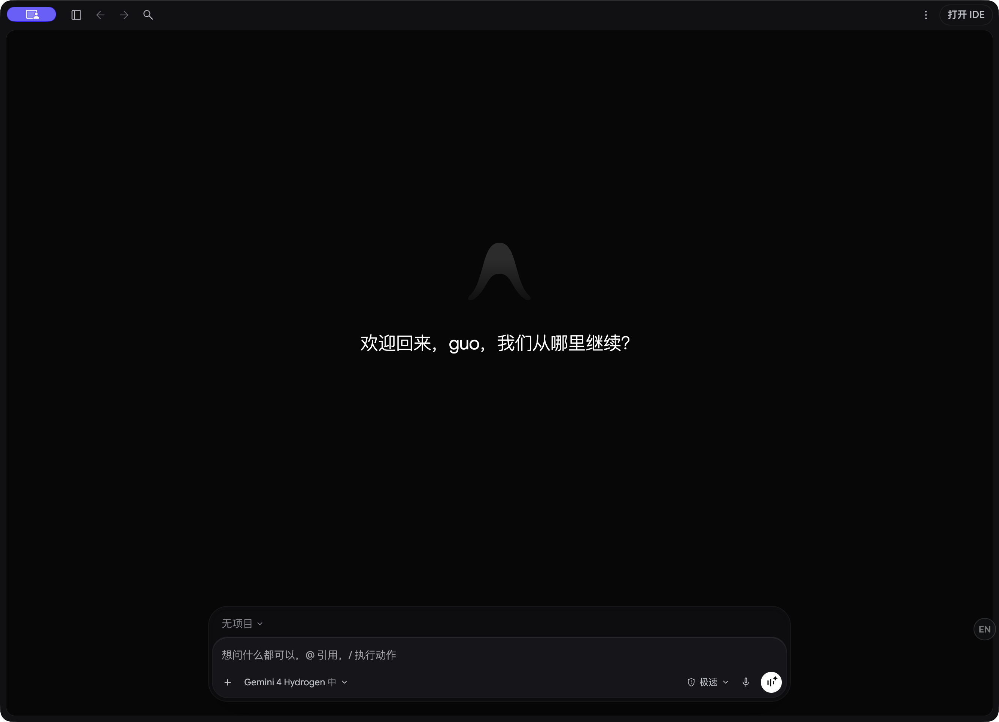

# Antigravity 中文

> 为 Antigravity 桌面端提供**开箱即用的完整中文体验** —— 安装后生成独立图标 **「Antigravity 中文」**，点开即享**中文界面 + AI 中文思考与回答**；原有的英文版 **Antigravity** 丝毫不动，双入口自由切换、互不干扰。

[简体中文](README.md) · [English](README.en.md)


<details>
<summary>查看更多实拍效果（新会话欢迎页与双入口图标）</summary>




</details>

## ⚡ 一行命令安装

**macOS**（打开「终端」粘贴运行）：

```bash
curl -fsSL https://raw.githubusercontent.com/guuguo/antigravity-zh-launcher/main/install.sh | bash
```

**Windows**（打开 **PowerShell** 粘贴运行）：

```powershell
irm https://raw.githubusercontent.com/guuguo/antigravity-zh-launcher/main/install.ps1 | iex
```

---

## ✨ 装完怎么用？

- **打开中文版**：在**桌面 / 开始菜单（Windows）**或 **应用程序 / 聚焦搜索（macOS）**中打开 **「Antigravity 中文」**，界面自动变中文，AI 也会全程用中文思考和回答。
- **保留英文原版**：平时直接点原有的 **Antigravity** 图标，依然是原汁原味的英文界面与英文思考，完全不受影响。
- **退出自动还原**：关闭中文会话或切回原版后会自动还原默认状态，双入口长期共存不串味。

---

## 🗑️ 不想用了？一行命令还原

随时可移除中文入口并恢复原状，不影响原版 Antigravity：

**macOS：**

```bash
curl -fsSL https://raw.githubusercontent.com/guuguo/antigravity-zh-launcher/main/uninstall.sh | bash
```

**Windows (PowerShell)：**

```powershell
irm https://raw.githubusercontent.com/guuguo/antigravity-zh-launcher/main/uninstall.ps1 | iex
```

---

[查看进阶使用说明（自定义中文提示词 / 命令行工具 / 彻底清理） →](docs/usage.md)

## 致谢与许可

- 界面汉化能力由 [yuexps/Antigravity-Hans](https://github.com/yuexps/Antigravity-Hans) 提供 · 基于 [MIT License](LICENSE) 开源
