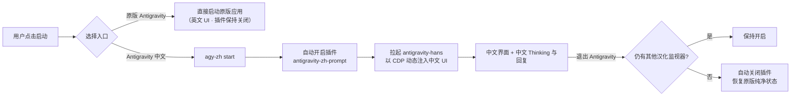

<div align="center">

# Antigravity 中文启动器 (`antigravity-zh-launcher`)

**Google Antigravity 2.0 无损双入口中文启动器 & 全流程中文思考提示词联动套件**

[简体中文](README.md) · [English](README.en.md)

[](LICENSE)
[](#一分钟极速安装)
[](#核心特色)
[](#为什么选择双入口无损方案)

</div>

---

大多数用户既想偶尔用纯正的**原版英文环境**，又希望日常使用 **Antigravity 中文版** 时**不仅界面是中文，连 AI 的内部思考（Thinking）、规划（Plan）和最终回复也尽量全程说中文**。

`antigravity-zh-launcher` 为你创建一个完全独立的 **「Antigravity 中文」** 入口：

- **从原版入口启动**：100% 原厂英文界面 + 100% 原始提示词环境，互不干扰。
- **从「Antigravity 中文」启动**：自动激活全流程中文思考提示词插件 + 拉起 CDP 动态界面汉化；当你退出中文模式时，提示词插件**自动关闭复原**。

---

## 核心特色

- **双入口彻底隔离**：原版 `Antigravity` 与独立 `Antigravity 中文` 共存，再也不用为了切换语言去手动改 `GEMINI.md` 或覆盖应用包。
- **零改包、不破签名**：绝不修改 `app.asar` 与应用可执行文件，完整保留 Google 官方代码签名与 macOS `ElectronAsarIntegrity` 校验；系统权限、钥匙串登录态与官方自动更新不受任何影响。
- **全流程中文思考与输出联动**：通过 Antigravity 官方原生 Plugin 机制（`~/.gemini/config/plugins/antigravity-zh-prompt`）在中文会话期间自动引导：
  - **Thinking / 推理链**与 **Plan / 方案规划**尽量使用简体中文；
  - **回复内容、文档产物（Artifacts）、工具步骤摘要（`toolSummary`）及子代理描述**使用简体中文；
  - 代码标识符、命令参数、路径与原始报错保留英文原样，不强行机翻。
- **界面中英实时无缝切换**：生效后窗口右下角会出现半透明「**中 / EN**」悬浮小圆点，支持一键实时切换语言、拖动位置，以及「选项名保留英文」预设。
- **一行命令安装与卸载**：macOS（Apple Silicon / Intel）与 Windows 开箱即用，自动校验底层汉化组件 SHA-256。

---

## 为什么选择双入口无损方案？

| 方案维度 | 传统 ASAR 静态改包 | 直接把中文要求写死在全局 `GEMINI.md` | **本项目（双入口无损联动）** |
| --- | --- | --- | --- |
| 原版应用完整性与官方签名 | 破坏（需重签 / 可能影响更新与钥匙串） | 不破坏（但无界面汉化） | **100% 保留原版应用与官方签名** |
| 原版英文入口纯净度 | 无原版入口（全局被改） | 全局被中文规则污染 | **原版入口完全纯净，互不干扰** |
| 界面汉化覆盖 | 改包后生效，升级会失效 | 无界面汉化 | **CDP 动态注入（支持中/英实时切换）** |
| AI 思考链（Thinking）中文 | 不管思考过程 | 有效，但影响原版入口 | **仅在「Antigravity 中文」入口启用，退出即关** |
| 卸载与恢复成本 | 需还原备份 `app.asar` | 手动修改配置文件 | **一行命令彻底无痕卸载** |

---

## 工作原理与生命周期



---

## 一分钟极速安装

> **前置条件**：本机已安装 [Google Antigravity 2.0+](https://antigravity.google)。安装过程中会自动从上游官方 Release 拉取 `antigravity-hans` 并完成 **SHA-256 校验**。

### macOS（Apple Silicon & Intel）

打开终端（Terminal），运行一行命令：

```bash
curl -fsSL https://raw.githubusercontent.com/guuguo/antigravity-zh-launcher/main/install.sh | bash
```

安装完成后将会自动生成：
- 独立启动应用：`/Applications/Antigravity 中文.app`（支持从启动台 / Spotlight 直接搜索启动，且配置了 `LSUIElement`，Dock 栏不会出现重复的第二个图标）
- 命令行编排工具：`~/.local/bin/agy-zh`
- 原生提示词插件：`~/.gemini/config/plugins/antigravity-zh-prompt`（默认处于关闭状态）

### Windows（10 / 11）

打开 PowerShell，运行一行命令：

```powershell
irm https://raw.githubusercontent.com/guuguo/antigravity-zh-launcher/main/install.ps1 | iex
```

安装完成后将会自动生成：
- 桌面快捷方式：`Antigravity 中文`（已继承原版应用图标，无控制台黑框弹出）
- 本地套件与命令：`%LOCALAPPDATA%\antigravity-zh-launcher\bin\agy-zh.cmd`
- 原生提示词插件：`%USERPROFILE%\.gemini\config\plugins\antigravity-zh-prompt`（默认处于关闭状态）

---

## 日常使用指南

1. **打开中文版**：直接打开 **「Antigravity 中文」**（macOS 应用程序 / Spotlight，或 Windows 桌面快捷方式）。
   > **注意**：如果原版 Antigravity 当前已经在运行，请先完全退出原版（macOS 按 `⌘Q`），再打开「Antigravity 中文」，以便加载调试端口并注入中文界面。
2. **打开原始英文版**：退出中文版后，照常打开原版 **Antigravity** 即可，界面和提示词都会保持 100% 原始英文状态。
3. **快速切换中英文界面**：在中文模式下，窗口右下角会出现半透明 **「中 / EN」** 小圆钮：
   - **单击**：在中文 / 英文界面间即时切换，无需重启；
   - **右键 / 双击**：打开菜单，可勾选「选项名保留英文」（如保留模型名与权限预设英文名）；
   - **拖动**：自由调整小圆钮在窗口中的位置。

---

## CLI 管理命令速查

macOS 终端中可直接使用 `agy-zh`（Windows 可使用 `%LOCALAPPDATA%\antigravity-zh-launcher\bin\agy-zh.cmd`）：

| 命令 | 作用说明 |
| --- | --- |
| `agy-zh start` | 开启中文思考插件并启动 Antigravity 中文版（退出自动复原） |
| `agy-zh stop` | 立即停止后台汉化监视器，并关闭中文思考提示词插件 |
| `agy-zh status` | 查看原版/中文双入口、底层引擎、插件安装状态与当前开关 |
| `agy-zh prompt on \| off \| status` | 手动开启、关闭或查看 `antigravity-zh-prompt` 插件状态 |
| `agy-zh shortcut` | 重新生成系统「Antigravity 中文」启动入口 |

---

## 自定义中文思考提示词

提示词规则文件位于：
- macOS：`~/.gemini/config/plugins/antigravity-zh-prompt/rules/AGENTS.md`
- Windows：`%USERPROFILE%\.gemini\config\plugins\antigravity-zh-prompt\rules\AGENTS.md`

你可以按个人偏好自由编辑其中的内容（例如追加特定技术栈偏好、代码注释风格要求等）。修改后仅会在通过 **「Antigravity 中文」** 启动时生效，依然不会影响原版入口。

---

## 一键无痕卸载

不想继续使用时，运行对应平台的一行卸载命令即可恢复到安装前的纯净状态：

- **macOS**：
  ```bash
  # 卸载启动器、桌面包装应用与提示词插件
  curl -fsSL https://raw.githubusercontent.com/guuguo/antigravity-zh-launcher/main/uninstall.sh | bash

  # 如需连同底层汉化引擎 ~/.local/bin/antigravity-hans 一起彻底清理：
  curl -fsSL https://raw.githubusercontent.com/guuguo/antigravity-zh-launcher/main/uninstall.sh | bash -s -- --purge
  ```

- **Windows (PowerShell)**：
  ```powershell
  # 卸载启动器、桌面快捷方式与提示词插件
  irm https://raw.githubusercontent.com/guuguo/antigravity-zh-launcher/main/uninstall.ps1 | iex
  ```
  *(本地下载后运行 `./uninstall.ps1 -Purge` 可连同引擎目录彻底删除)*

---

## 致谢与声明

- 界面动态注入核心引擎由开源项目 **[yuexps/Antigravity-Hans](https://github.com/yuexps/Antigravity-Hans)** 强力驱动，本仓库不二次分发其二进制产物，所有安装脚本均实时从上游 GitHub Release 下载并严格核验 `SHA256SUMS`。
- 本项目为社区开源工具，与 Google LLC 及 Google Antigravity 官方无任何从属或背书关系。
- 开源协议：[MIT License](LICENSE)
